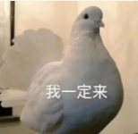

# SegBench: A simple toolbox for Implementing Binary Segmentation

## Introduction

This project aims to build up a benchmark for **fair and solid comparisons** with the *state-of-the-art* segmentation methods. Motivated by [sssegmentation](https://github.com/SegmentationBLWX/sssegmentation), we hope to excel at the **Binary Segmentation & Matting task** which is prevailing in minority tasks but also matters, e.g., **Shadow Detection, Camouflage Object Detection, Saliency Object Detection, and most of Medical Image Segmentation**. 

In a sum, we:

* Present read and deployment-friendly codes for Training/Testing
* Present a wide range of cutting-edge methods comparisons with several datasets
* Provide full experiment details including the logs, ~~tensorboard~~（too large, forget it **😅**）, and ckpt

<center><b>Give me some time to construct this project :)</b></center>




## Environments

The codes mainly rely on the **[HuggingFace](https://huggingface.co/)🤗**, including the Distributed Training (**[Accelerate](https://huggingface.co/docs/accelerate/index)**), Model Architecture (**[Transformers](https://huggingface.co/docs/transformers/index)**).

**Must have Packages:** 

```
pip install accelerate    # distribute training
pip install xformers	  # flash attn accleration
pip install torch>=2.6.0  # stable version 
```


## Notation:

Currently, for my convenience, **I have fixed some parameters for some gpu platform (e.g., I have to mount different storage)**

* The dataset path in `main.py`
* The output path in `main.py`
* The model weights. Please carefully check and replace with yours.


## Datasets

### Shadow Detection

* BIGSHA(coming soon): High Resolution Shadow Detection
* [SBU](https://www3.cs.stonybrook.edu/~cvl/projects/shadow_noisy_label/index.html) (ECCV16): Image Shadow Detection
* [CUHK-Shadow ](https://github.com/xw-hu/CUHK-Shadow)(TIP21): Image Shadow Detection, larger one 

### Camouflaged object detection

* [COD10K](https://openaccess.thecvf.com/content_CVPR_2020/papers/Fan_Camouflaged_Object_Detection_CVPR_2020_paper.pdf) (CVPR20): Image Camouflaged object detection

### Transparent Segmentation

*  [Trans10k ](https://xieenze.github.io/projects/TransLAB/TransLAB.html)(ECCV20) : Transparent objects segmentation:

### Medical Image Segmentation

*  [ISIC [RGB image] ](https://www.isic-archive.com/): Skin Lesion Segmentation, 
*  [BUSI [ultrasound]](https://www.kaggle.com/datasets/aryashah2k/breast-ultrasound-images-dataset) : Breast Cancer Ultrasound Image Segmentation
*  BCN[pathology]: Breast Cancer Mitosis Nuclei Segmentation
*  MHSI[pathology] : Melanoma Segmentation
*  GlaS [pathology] : Intestinal Glandular Structures Segmentation

### And So On


## Detailed Documents

Please check the corresponding doc to find the **model card, implement configs, and visualization**

* Interest on **Natural Scenario** ?       👉️👉️👉️ Check  [Natural Scenario Documents (TODO)](https://www.youtube.com/watch?v=dQw4w9WgXcQ)
* Interest on **Medical Images** ?         👉️👉️👉️ Check  [Medical Documents (TODO)](https://www.youtube.com/watch?v=dQw4w9WgXcQ)


## Future works

So many blanks need to fill  :)

Keep Patience :)

Drop emails to haipengzhou856@gmail.com or directly post the issues here if you have any questions.


## Acknowledgement

Thanks for all the open-source and code-sharing contributors. 

Please considering to cite those datasets and the reproduced methods.

This codebase is built on  **[HuggingFace](https://huggingface.co/)🤗**.

## License

Currently, the project is under CC BY-NC 2.0, **Any kinds of modification is welcome**.

But **Forbidden** Commercial Usage.

All Copyright **©** [Rydeen, Haipeng ZHOU](https://haipengzhou856.github.io/)

